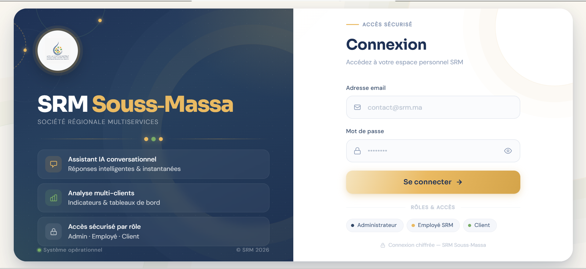
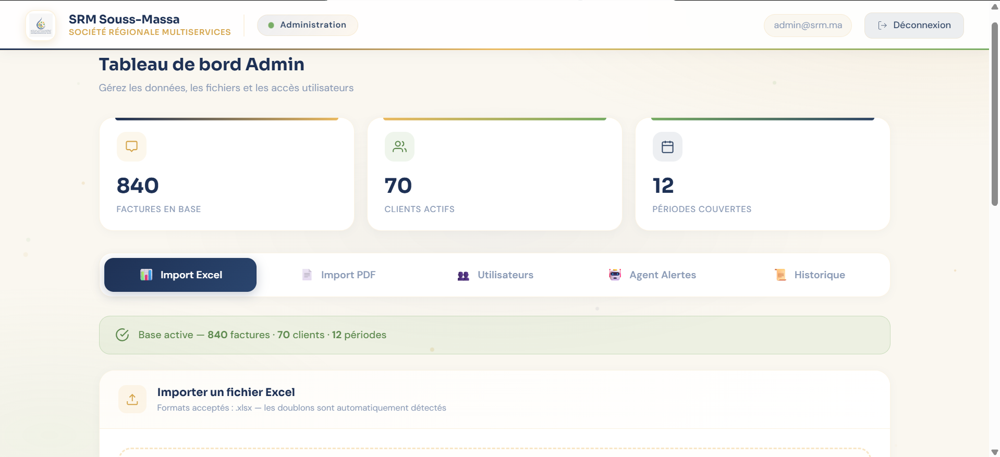
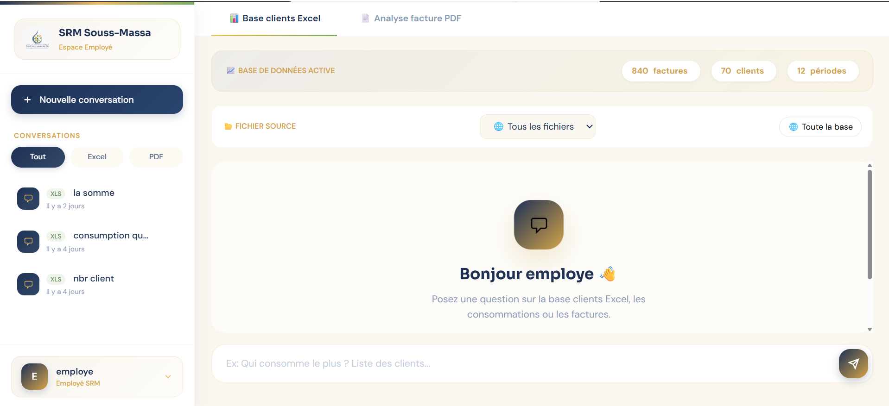
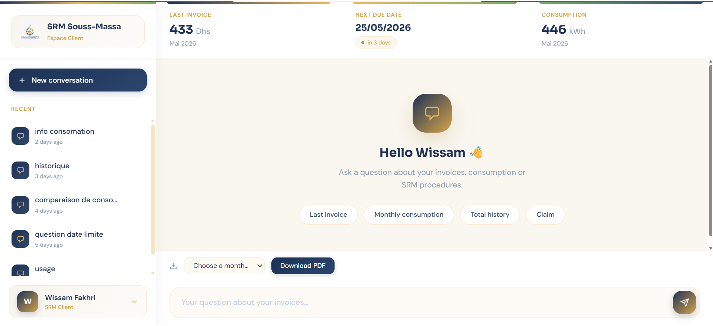

<div align="center">


# 🧾 SRM Intelligent Billing System

> Système Intelligent de Gestion des Factures — SRM Souss-Massa

**Réalisé par : BEN ZHIR Wafa**
Encadrant entreprise : **ZEROUALI Hassan** · Encadrant académique : **AIT BAHA Tarek**
*Stage de fin d'études — EST Guelmim, Filière SDSI 2025–2026*

</div>

---

## Vue d'ensemble

Ce projet est un système complet de gestion intelligente des factures développé pour la **SRM Souss-Massa** dans le cadre d'un stage de fin d'études. Il repose sur une **architecture hybride LLM as a Router** qui garantit des réponses déterministes et fiables en confiant au LLM uniquement la compréhension du langage naturel, tandis que Python et SQL assurent l'intégralité des calculs et du traitement des données.

Le système évolue en trois phases :

| Phase | Statut | Description |
|---|---|---|
| **Tâche 1** | ✅ Terminée | Système complet de gestion et d'analyse des factures avec 3 interfaces dédiées |
| **Tâche 2** | 🔄 En cours | Agent autonome de détection des surconsommations et alertes email |
| **Tâche 3** | 📋 Planifiée | Containerisation Docker + déploiement sur infrastructure SRM |

---

## Aperçu des interfaces

### 🔐 Page de connexion



---

### 🛠️ Interface Administrateur



---

### 👨‍💼 Interface Employé SRM



---

### 👤 Interface Client Connecté



---

## Architecture IA — Pipeline Employé SRM

Le pipeline employé repose sur un mécanisme de décision hiérarchique à 4 niveaux. Le LLM joue **uniquement le rôle de routeur sémantique** — il n'intervient jamais dans le calcul ou la génération des réponses finales sur les données.

> Ce paradigme s'inscrit dans le cadre des *LLM augmentés par des outils* (Mialon et al., 2023 ; Schick et al., 2023 — Toolformer).

```
Question utilisateur (Interface Employé)
        │
        ▼
┌─────────────────────────────────────────┐
│  Niveau 0 — Portail de validation       │
│  Champ inexistant dans la base ?        │──→ Message d'indisponibilité immédiat
└─────────────────────────────────────────┘
        │ Non
        ▼
┌─────────────────────────────────────────┐
│  Niveau 1 — Règles Python               │
│  Mot-clé / intent reconnu ?             │──→ Réponse déterministe (sans LLM)
└─────────────────────────────────────────┘
        │ Non
        ▼
┌─────────────────────────────────────────┐
│  Niveau 2 — LLM Router (Mistral)        │
│  Classificateur d'intention uniquement  │──→ Validation en 3 couches avant routage
└─────────────────────────────────────────┘
        │ Intent non reconnu
        ▼
┌─────────────────────────────────────────┐
│  Niveau 3 — Fallback Text-to-SQL        │
│  Génération SQL contrainte              │──→ Whitelist SELECT + Validation schéma
└─────────────────────────────────────────┘
```

---

## Architecture IA — Pipeline Client Connecté

Le pipeline client est distinct du pipeline employé. Il intègre deux mécanismes absents chez l'employé : un **routeur amont General/Personnel** qui distingue les questions sur les factures des questions générales sur la SRM, et un **intent ANALYSE** qui permet des réponses narratives personnalisées combinant données réelles et génération LLM.

```
Question utilisateur (Interface Client)
        │
        ▼
┌─────────────────────────────────────────┐
│  Niveau 0 — Routeur General / Personnel │
│  Détection automatique du contexte      │
│                                         │
│  Question générale SRM ?                │──→ Base de connaissance SRM
│  (abonnement, branchement, stage,       │    (abonnement, contact, recrutement,
│   recrutement, contact...)              │     sensibilisation eau/électricité)
│                                         │
│  Question personnelle sur factures ?    │──→ Pipeline personnel (suite)
└─────────────────────────────────────────┘
        │ Personnelle
        ▼
┌─────────────────────────────────────────┐
│  Niveau 1 — Champ précis du profil      │
│  Usage, agence, compteur, contrat ?     │──→ Réponse ciblée (champ unique)
└─────────────────────────────────────────┘
        │ Non
        ▼
┌─────────────────────────────────────────┐
│  Niveau 2 — Règles Python déterministes │
│  Année / Top N / Comparaison /          │──→ Réponse déterministe filtrée
│  Mois spécifique / Mois relatifs /      │    par numéro de contrat (sans LLM)
│  Max / Min / Somme / Évolution...       │
└─────────────────────────────────────────┘
        │ Non couvert
        ▼
┌─────────────────────────────────────────┐
│  Niveau 3 — Fallback LLM                │
│  • Questions hors règles → LLM Router   │──→ Réponse guidée avec exemples
│  • Intent ANALYSE → LLM narratif        │──→ Réponse personnalisée avec données
│    (données réelles injectées,          │    réelles, comparaison mois actuel
│     zéro hallucination sur les chiffres)│    vs précédent, saisonnalité marocaine
└─────────────────────────────────────────┘
```

---

## Différences entre les deux pipelines

| | Pipeline Employé | Pipeline Client |
|---|---|---|
| **Données accessibles** | Tous les clients (multi-contrats) | Uniquement son contrat (isolation totale) |
| **Routeur amont** | Portail de validation (champs inexistants) | Routeur General / Personnel |
| **Niveau LLM** | Classificateur d'intention strict + validation 3 couches | Classificateur + intent ANALYSE narratif |
| **Fallback final** | Text-to-SQL sécurisé (whitelist + schéma) | LLM narratif avec données réelles injectées |
| **Base de connaissance** | Non | Oui — questions générales SRM (abonnement, contact, stage...) |
| **Analyse personnalisée** | Non | Oui — explication des variations, conseils adaptés à l'usage et à la saisonnalité |

---

## Interfaces & Fonctionnalités

### Interface Administrateur
- Import de fichiers Excel multi-clients / multi-périodes et factures PDF
- Gestion de la base de données SQLite
- Gestion des comptes utilisateurs (création, suppression, rôles)
- **Agent Alertes** : détection des surconsommations, envoi ciblé ou en masse, historique complet

### Interface Employé SRM
- **Assistant conversationnel PDF** : analyse de factures individuelles via RAG classique
- **Assistant Excel multi-clients** : interrogation via l'architecture hybride LLM as a Router
- Filtre par fichier Excel source pour des analyses ciblées
- **Persistance des conversations** : historique sauvegardé en base, consultable et renommable depuis la sidebar
- **Multilinguisme** : interface disponible en français, anglais et arabe

### Interface Client Connecté
- Authentification sécurisée par email
- Chatbot personnalisé filtré automatiquement par numéro de contrat (isolation totale des données)
- Mini-dashboard : dernière facture, prochain paiement, graphique de consommation
- Téléchargement de factures PDF personnalisées (ReportLab)
- Base de connaissance institutionnelle SRM (abonnement, branchement, contacts)
- **Persistance des conversations** : historique sauvegardé par client, accessible après reconnexion
- **Multilinguisme** : interface disponible en français, anglais et arabe

---

## Agent Alertes — Tâche 2

### Mode Manuel (Admin)

L'admin peut déclencher la détection depuis l'interface et choisir entre deux modes :

| Mode | Méthode | Avantage |
|---|---|---|
| **Mode 1** | Comparaison mois précédent | Détection immédiate des hausses soudaines |
| **Mode 2** | Moyenne historique 6 mois | Élimine les fausses alertes dues à un mois anormalement bas |

Envoi individuel, par sélection, ou en masse. Historique des alertes avec export CSV, déduplication anti-doublons.

### Mode Automatique (APScheduler)

L'agent tourne **sans intervention humaine** — planifié automatiquement via APScheduler. Par défaut il utilise le **Mode 2 (moyenne historique)** pour réduire les fausses alertes. L'admin reçoit un rapport récapitulatif après chaque exécution.

Fonctionnalités communes : seuil configurable, template email HTML avec niveaux de criticité (modéré / élevé / critique), distinction source manuel / automatique dans l'historique.

---

## Tech Stack

| Couche | Technologie | Rôle |
|---|---|---|
| Langage | Python 3.10.9 | Développement principal |
| Backend | FastAPI + Jinja2 | Routes HTTP, sessions par cookies, routage par rôle |
| Frontend | Tailwind CSS | Design des interfaces |
| LLM | Mistral via Ollama | Classificateur d'intention uniquement (local) |
| Extraction PDF | pdfplumber | Lecture des factures PDF |
| Génération PDF | ReportLab | Factures personnalisées téléchargeables |
| Base de données | SQLite | Persistance des données et conversations |
| Traitement Excel | pandas / openpyxl | Lecture multi-clients / multi-périodes |
| Similarité texte | fuzzywuzzy | Détection des noms mal orthographiés |
| Sécurité | hashlib SHA-256 | Hashage des mots de passe |
| Planification | APScheduler | Agent autonome planifié |

> **Note sur la migration UI :** Le prototype initial a été développé sous Streamlit, puis migré vers FastAPI + Jinja2 + Tailwind CSS pour lever les contraintes de personnalisation UI. La migration a été réalisée sans aucune régression fonctionnelle, confirmant la solidité de l'architecture modulaire adoptée dès le départ.

---

## Sécurité

- Authentification par email avec hashage **SHA-256**
- Système de rôles : **Admin / Employé / Client**
- **Isolation totale** des données client par numéro de contrat
- Validation du schéma SQL avant toute exécution (rejet des colonnes inexistantes)
- Whitelist SELECT : rejet de toute instruction de modification (INSERT, UPDATE, DELETE, DROP...)
- Le LLM tourne **entièrement en local** via Ollama — aucune donnée ne quitte la machine

---

## Prérequis

- **Python 3.10.9** : [python.org](https://www.python.org/downloads/release/python-3109/)
- **Ollama** : [ollama.com](https://ollama.com/)
- **Git**

---

## ⚡ Lancement

```bash
# 1. Cloner le dépôt
git clone https://github.com/BenWafae/srm-intelligent-billing-system.git
cd srm-intelligent-billing-system

# 2. Installer les dépendances
pip install -r requirements.txt

# 3. Télécharger le modèle Mistral
ollama pull mistral

# 4. Lancer l'application
uvicorn main:app --reload
```

L'application est accessible sur `http://localhost:8000`

> Au premier lancement, Ollama peut prendre quelques secondes pour charger le modèle Mistral en mémoire.

---

## Rôles & Accès

| Rôle | Accès |
|---|---|
| **Admin** | Import données, gestion utilisateurs, agent alertes, historique |
| **Employé** | Assistant complet : analyse PDF + interrogation multi-clients Excel |
| **Client** | Espace personnel : ses factures uniquement + téléchargement PDF |

> Les comptes sont créés et gérés par l'Admin depuis son interface.